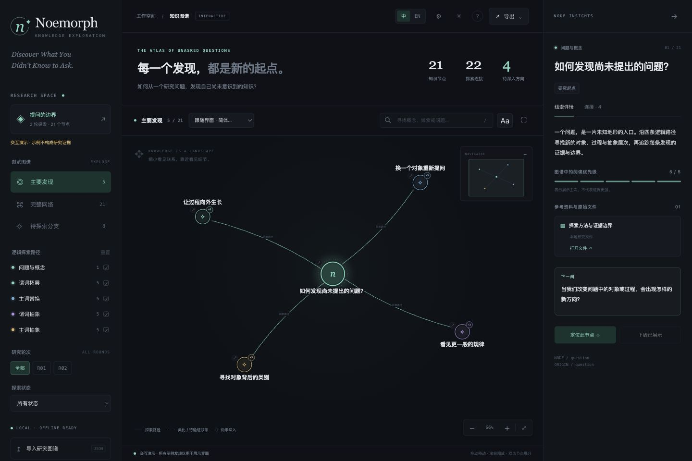

# Go beyond the question you asked. Discover the questions you didn't know existed.

**Noemorph** 从你的一个研究问题出发，帮助你发现新的研究方向、建立跨学科联系，并把探索过程整理成可以继续展开的交互知识图谱。

走出最初问题的边界，发现那些你还不知道可以提出的问题。

一个开源的 **AI 研究技能（Agent Skill）**，用于**研究问题生成、假设探索、跨学科知识发现与递归深度研究**。把问题交给你的 AI Agent，看看它还能通向哪里。

[开始使用](#开始使用) · [看看你会得到什么](#一张可以继续探索的知识地图) · [English](README.md)



*交互界面预览，图中内容为演示数据。*

## 已经有了问题，下一步该往哪里走？

你熟悉这个主题，也读过容易找到的论文，但下一个值得研究的问题仍然不清晰。

Noemorph 帮你重新打开问题的边界：还有哪些解释？同样的过程会不会出现在另一类系统中？别的领域有没有可以借鉴的思路？有潜力的方向会进入更深入的调查，相关来源、不确定性和待解问题也会一起保留下来。

你可以用它来：

- **寻找下一个研究问题**：从一个主题或初步假设出发，探索值得继续调查的方向。
- **建立跨学科联系**：寻找共同机制、有启发的类比，以及这些联系成立的条件。
- **重新审视熟悉的解释**：换一个对象、过程或分析尺度，观察问题如何变化。
- **形成研究计划**：保留可继续推进的路径、支持它们的证据，以及尚未解决的问题。

## 从一个让你好奇的问题开始

安装后，可以这样告诉你的 Agent：

> 用 Noemorph 探索这个问题：为什么有些在线社区能够留住有用的知识，而另一些社区总在反复遗忘？寻找跨学科联系，把有潜力的想法发展成可研究的问题。运行两轮，每轮深入四条路径，输出中文报告和交互知识图谱。保留来源、不确定性，以及没有入选深入研究的发现。

探索可以从这些问题展开：社区规模变化后，解释是否仍然成立？还有哪些系统能在成员更替中保存信息？关于记忆的研究，哪些适合迁移到社区层面？这些只是示意性的探索起点，并非已经完成的研究结论。

**换成你自己的问题、假设，或一个难以解释的观察。** 由你决定研究范围与探索深度。

## 一张可以继续探索的知识地图

你会得到一份相互连接、可追溯的探索记录：

| 你会得到 | 可以用它做什么 |
| --- | --- |
| **新的研究方向** | 发现超出最初框架的问题，也能查看没有被选中深入研究的路径。 |
| **带来源的研究路径** | 追踪每个发现如何引出下一个问题，查看证据、假设与尚存的缺口。 |
| **交互知识图谱** | 展开分支、搜索隐藏节点、筛选发现，并跳转到资料链接。 |
| **综合报告与完整知识目录** | 先理解主要发现，再随时回到全部探索记录。 |
| **可分享的文件** | 导出 HTML、JSON 或 SVG；分享时将关联的本地附件一并保留。 |

图谱查看器可以在本地浏览器运行，支持明暗主题，并分别控制界面语言与已有的内容翻译版本。

想先体验图谱？克隆仓库后，在仓库的上一级目录运行：

```sh
cd noemorph
python3 scripts/serve.py --port 8765
```

打开 <http://127.0.0.1:8765>。也可以下载[独立 HTML 示例](examples/knowledge-map.html)，在本地打开。示例使用合成数据展示交互功能。

## 开始使用

Noemorph 在你的 AI Agent 客户端中运行。选择**一种**安装方式，然后让 Agent 用 Noemorph 探索你的问题。

<details open>
<summary><strong>Codex</strong></summary>

```sh
mkdir -p ~/.agents/skills
git clone https://github.com/21sjhhs/noemorph.git ~/.agents/skills/noemorph
```

</details>

<details>
<summary><strong>Claude Code</strong></summary>

```sh
mkdir -p ~/.claude/skills
git clone https://github.com/21sjhhs/noemorph.git ~/.claude/skills/noemorph
```

</details>

<details>
<summary><strong>Cursor</strong></summary>

```sh
mkdir -p ~/.cursor/skills
git clone https://github.com/21sjhhs/noemorph.git ~/.cursor/skills/noemorph
```

</details>

必要时刷新技能发现或重启客户端，然后输入：**“用 Noemorph 探索［你的问题］。”** Claude Code 也支持 `/noemorph`。技能发现与触发取决于客户端，尚未在每一种客户端中完成原生激活测试。

其他客户端可将完整的 `noemorph` 文件夹放进其支持的技能目录，或让 Agent 读取其中的 `SKILL.md`。有来源的研究需要客户端提供检索工具；独立研究 Agent 需要真实的委派能力。本地工具使用 Python 3.10+ 标准库，无需额外 Python 依赖。项目不附带 API 密钥或模型运行环境。

开始前，Agent 会收集你的问题、范围、轮数、深入路径数和输出语言。更完整的请求写法见[研究请求示例](examples/research-request.md)。

## 探索如何继续生长

**你的问题 → 新方向 → 深入调查 → 关联发现 → 新的问题。**

每轮先澄清原始问题，再从四种互补视角向外探索。Agent 比较候选方向，深入调查入选路径，并用新发现更新下一轮的问题。研究范围与停止位置由你控制；未被选中的发现也会保留下来。

Noemorph 将概念拓展、递归深度研究与知识图谱探索结合在一起。具体方法见[研究流程](references/WORKFLOW.md)与[架构说明](references/ARCHITECTURE.md)。

## 使用前的几个问题

**它会自己运行研究吗？** 它是一个 Agent Skill，由你的客户端提供模型、检索与执行能力。附带脚本负责收集设置、检查记录和生成图谱。

**客户端不能运行独立 Agent 怎么办？** 可以按顺序执行并分别记录各个角色，同时明确说明限制。独立上下文需要客户端实际支持委派。

**图里的每条联系都可靠吗？** 输出需要区分证据、假设、类比与未解问题。值得探索的联系仍需要进一步核查。项目处于早期 Alpha，端到端研究验收尚未完成；实际检查与能力边界见[验收报告](QA_REPORT.md)。

**如何更新或卸载？** 对没有本地改动的克隆运行 `git -C <你的技能目录>/noemorph pull --ff-only`。卸载时，将文件夹移出客户端技能目录并刷新技能发现即可。操作前先保存本地修改。

## 继续了解

[技能说明](SKILL.md) · [研究流程](references/WORKFLOW.md) · [图谱格式](docs/graph-format.md) · [开发与检查](docs/development.md) · [供 AI 读取的项目概览](llms.txt)

欢迎改进文档、研究流程与图谱查看器。验证和打包命令见开发指南。

采用 [Apache-2.0](LICENSE) 许可。归属与第三方材料边界见 [NOTICE](NOTICE)。


每次最终图谱交付必须包含英文，以及用户选择的其他内容语言；未包含英文的配置会自动补入 `en`。翻译覆盖节点、连线详情及资料说明。混合原始记录使用 `und`，缺少目标版本时最终导出会报错；`--allow-incomplete-languages` 仅用于原始记录预览。详见[语言交付要求](references/11-language-variants.md)。
